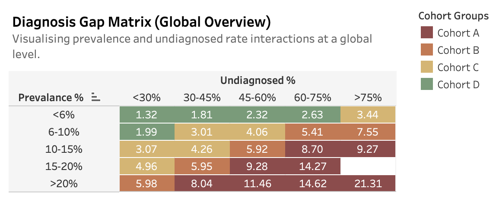
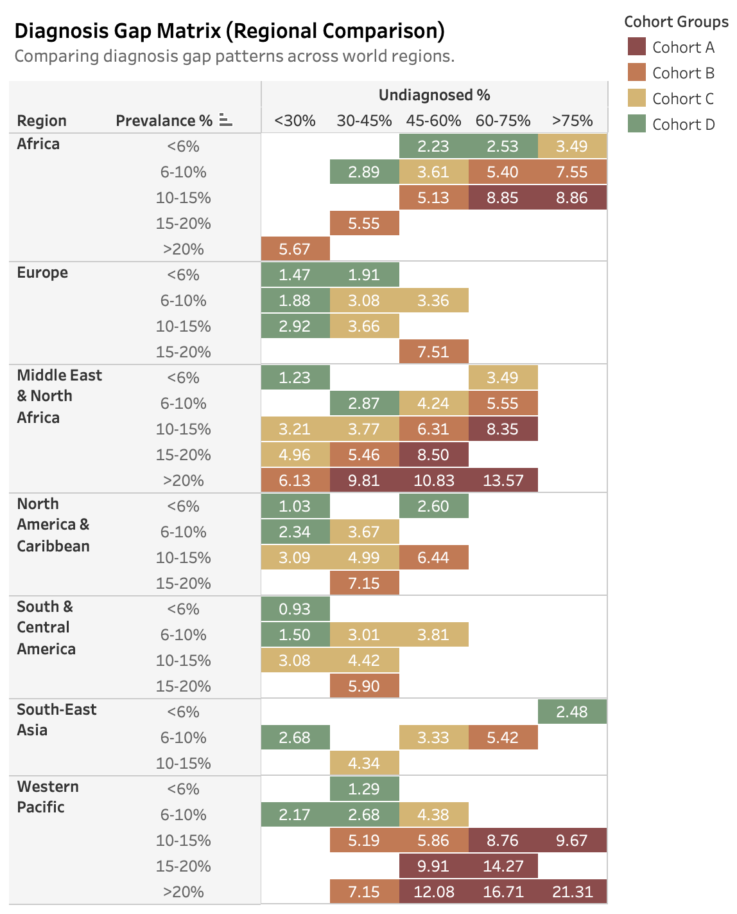
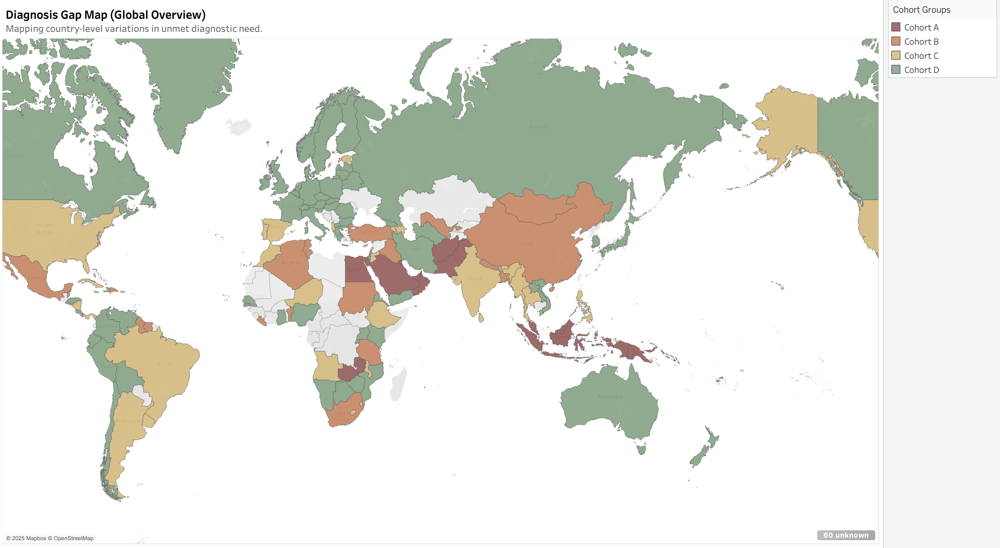

# **Global Diabetes Diagnosis Gap Insights – Project Overview**

**The goal of this project is to identify high-need regions with the largest diagnosis gaps in diabetes care and translate these findings into recommendations for public health planning and market access strategy.**

Diabetes continues to rise globally, yet millions remain undiagnosed, leading to delayed treatment, higher mortality, and increasing healthcare costs. Using data from the **International Diabetes Federation (IDF) Diabetes Atlas, 11th Edition (2025)**, this analysis measures the scale of undiagnosed diabetes and highlights regions where early detection initiatives would yield the most significant outcomes.

To quantify this diagnosis gap, the analysis introduces a **Diagnosis Gap Rate**, which estimates the share of adults living with undiagnosed diabetes by combining disease prevalence and diagnostic coverage into a single comparable measure. This rate enables public health and healthcare stakeholders to identify high-need regions where targeted screening, awareness campaigns, or diagnostic programs could deliver measurable benefit.

---

## **Dataset Structure**

The dataset consolidates global indicators related to diabetes prevalence and diagnostic coverage, supported by additional derived fields created for analytical interpretation. Each observation represents a country-level estimate, including both raw epidemiological indicators and calculated measures for segmentation and visualisation. Regional groupings were derived and mapped in Python to enable broader cross-market analysis and comparison.

| **Field** | **Type** | **Source / Derived** | **Description** |
|:-----------|:----------|:---------------------|:----------------|
| **Country** | Text | Original | Country name |
| **Region** | Text | Derived | Regional grouping mapped in Python for cross-market comparison |
| **Prevalence_Pct** | Float | Original | Estimated diabetes prevalence (%) |
| **Undiagnosed_Pct** | Float | Original | Proportion of adults with diabetes who remain undiagnosed (%) |
| **Unmet_Need_Score** | Float | Derived | Composite indicator representing the diagnosis gap rate (DGR) |
| **Prevalence_Bucket** | Text | Derived | Grouped prevalence (%) bands for matrix visualisation |
| **Undiagnosed_Bucket** | Text | Derived | Grouped undiagnosed (%) bands for matrix visualisation |
| **Cohort_Groups** | Text | Derived | Diagnostic maturity category (A–D) based on DGR range |

## **Cohort Groups and Definitions**

Conditional formatting across the visualisations is based on the **Diagnosis Gap Rate (DGR)**, which represents the estimated proportion of adults with diabetes who remain undiagnosed.  

To support interpretability and comparison, DGR values were classified into 4 cohorts (A–D) representing progressive levels of diagnostic maturity.  

| **Cohort** | **Range (DGR %)** | **Interpretation** |
|:------------|:------------------|:-------------------|
| **A – Critical** | ≥ 8% | Highest priority for intervention and monitoring |
| **B – High** | 5 – < 8% | Significant diagnostic gap; targeted improvement needed |
| **C – Moderate** | 3 – < 5% | Partial diagnostic coverage; maintain improvement momentum |
| **D – Lower** | < 3% | Strong diagnostic coverage; sustain best practices |

While these numeric ranges are not standardised across global policy literature, they reflect the categorical framing commonly used in public-health and market-access contexts to describe diagnostic readiness. The thresholds were analytically defined to enable consistent regional comparison and to align with real-world interpretations of diagnostic performance.

---

## **Insights Summary**

- The **Diagnosis Gap Matrix** shows a consistent inverse relationship between diabetes prevalence and diagnostic coverage.  
- Countries in the lower-right quadrant (high prevalence > 15%, high undiagnosed > 60%) represent the largest diagnostic shortfalls.  
- Lower-prevalence countries (< 6%) typically maintain narrower diagnosis gaps, reflecting stronger screening systems and earlier disease detection.  
- The overall trend suggests that healthcare capacity declines as disease burden increases, highlighting the structural imbalance between prevalence and diagnostic readiness.  

### **Regional Insights**

- The **Western Pacific** region holds the highest concentration of **Cohort A** countries, marking it as the most urgent priority for diagnostic intervention.  
- **Middle East & North Africa** show multiple **Cohort A** and **B** countries, indicating persistent diagnostic inequities and high unmet need.  
- **Africa** also contains a substantial share of **Cohorts A and B**, reflecting a broad diagnostic gap across most prevalence levels.  
- **Europe** and **North America & Caribbean** are primarily **Cohort D**, representing strong diagnostic maturity and relatively low prevalence rates.  
- **South-East Asia** and **South & Central America** feature mixed performance across **Cohorts B–D**, signalling transitional diagnostic progress and variability in health system capacity.

### **Key Takeaways**

- Diagnostic coverage declines as prevalence rises, forming a global diagnostic performance gap.  
- The **Western Pacific**, **Middle East & North Africa**, and **Africa** are the highest-priority regions for early-detection programmes.  
- Strengthening screening infrastructure and diagnostic accessibility in these regions could significantly narrow the global diagnosis gap.
---

## **Recommendations**

- **Prioritise Cohorts A and B:** Direct diagnostic investments, awareness initiatives, and screening programmes to high-need regions including the Western Pacific, Middle East & North Africa, and Africa.  
- **Strengthen Cohort C systems:** Support moderately performing regions through improved access to screening, localised data collection, and early-detection campaigns.  
- **Leverage Cohort D examples:** Use well-performing regions as reference models for standardised testing, patient engagement, and policy design.  
- **Enhance data transparency:** Encourage harmonised reporting of diagnosed and undiagnosed populations to improve the precision of DGR estimates and enable better longitudinal tracking.

---

## **Dashboards**

The visual component of this project was developed in Tableau to explore diagnostic coverage patterns globally and regionally.  
Each dashboard visualises a different dimension of the diagnosis gap using the **Diagnosis Gap Rate (DGR)** and **Cohort classification (A–D)**.

  

  

  

